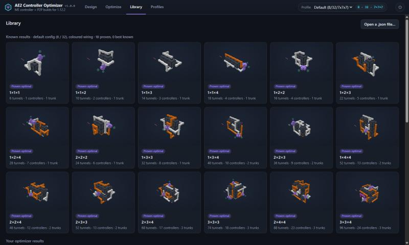

# AE2 Controller Optimizer

Design, check and optimize **ME controller + P2P tunnel** builds for **Applied Energistics 2 on
Minecraft 1.12.2**: AE2 rv6, and AE2 Unofficial Extended Life with your own config.

How many ME P2P tunnels can you fit around a controller of a given size, and how do you wire
them so every tunnel gets its channel? This app answers that exactly. For small controllers it
**proves** the best possible build; for big ones it finds very good builds and tells you how
far from the proven maximum they can be. Every build is checked by a channel simulator that
follows AE2's own pathfinding, and the results were confirmed in game.



## What it does

- **3D designer.** Build or edit a controller design and see it checked live. Hover any block
  for details: controller state, how many tunnels feed it, a cable's channel load (`7 / 8`), and
  each tunnel's status (`Device Online`, `Missing Channel`, `Offline`), the way WAILA would show
  it in game. X-ray, a channel heat map and a layer slider help with big builds.
- **Optimizer.** Pick a box size and let it search, with a live chart of the best build found
  against the proven maximum. Pause it to free your CPU, stop it, and continue later.
- **Known results built in.** Every box up to 4 per side is already proven optimal, and the
  best known builds for 5×5×5 to 7×7×7 are included. There's no need to
  re-run those on your PC; the Optimize tab tells you when a result is already known.
- **Easy-to-build wiring.** Tunnels sit on coloured smart cable in groups of up to 8, which feed
  a few fluix dense trunks. No cable anchors. The optimizer uses the fewest trunks it can.
- **Into the game.** Export any build as a structure-block `.nbt` file (optionally with a
  ready-made test rig), or open a build guide: materials list, colour by colour, and a
  layer-by-layer view.
- **Your pack's config.** Change channel capacities and controller size by hand, or import
  your `AppliedEnergistics2.cfg`.

## Download and run (Windows)

1. Download `AE2ControllerOptimizer-<version>-windows.zip` from
   [Releases](../../releases/latest) and unzip it anywhere.
2. Run `AE2ControllerOptimizer.exe`. The app opens in your web browser.

- **Windows SmartScreen** may say it's from an unknown publisher, because the app isn't
  code-signed. Choose **More info → Run anyway**.
- **Offline and private:** the app runs entirely on your PC (a small local server on
  `127.0.0.1`), needs no internet, and sends nothing anywhere.
- **Quitting:** use the power button at the top right. Closing the browser tab also works: the
  app exits a few minutes later, unless an optimizer run is still going.
- **Your files** (profiles and optimizer runs) are kept in `%APPDATA%\ae2opt`.

### Run from source (any OS)

Needs Python 3.11 or newer.

```bash
pip install -e ".[optimize]"
python -m ae2opt
```

Everything except the optimizer works without OR-Tools (`pip install -e .`).

## Quick tour

| Tab | What it's for |
|---|---|
| **Design** | Look at and edit a build. **Tools:** keys 1–8; with the tunnel tool, clicking a controller face adds a cable with a tunnel facing it. **Remove/undo:** right-click removes; Ctrl+Z undoes. **Issues:** click one to outline the blocks involved. **Output:** Export .nbt and Build guide are at the top. |
| **Optimize** | Start a run: box size, goal ("find a great build" or "prove the best"), time budget and CPU threads. The sliders stop at what your config and the optimizer allow. "Open in designer" shows the best build so far. |
| **Library** | Known results (proven and best known), and your own optimizer results. Click a card to open it. |
| **Profiles** | Channel capacities and controller size. Import a config file to fill them in; nothing is saved until you press Save. |

## Known results

For the default config (8 channels per smart cable, 32 per dense, 7×7×7 controllers), with
coloured anchor-free wiring and tunnels allowed both inside and around the box. Results hold
for any orientation of the box.

| Box | Tunnels | Channels | Controllers | Trunks | |
|---|---|---|---|---|---|
| 2×2×2 | 24 | 768 | 6 | 1 | proven |
| 2×3×3 | 52 | 1,664 | 13 | 2 | proven |
| 3×3×3 | **74** | 2,368 | 18 | 3 | proven |
| 3×3×4 | 96 | 3,072 | 24 | 3 | proven |
| 3×4×4 | **126** | 4,032 | 31 | 4 | proven |
| 4×4×4 | **164** | 5,248 | 41 | 6 | proven |
| 5×5×5 | 298 | 9,536 | 74 | 10 | best known, at most 324 |
| 6×6×6 | 484 | 15,488 | 122 | 18 | best known, at most 590 |
| 7×7×7 | 716 | 22,912 | 180 | 27 | best known, at most 1,047 |

The app has every box up to 4 per side (20 proven results). "At most" is the proven upper
bound: no build in that box can have more.

**Why bigger boxes aren't proven:** the solver proves a result by ruling out every better
possibility, and the work that takes grows explosively with box size. 4×4×4 took about an
hour on 16 threads, even starting from the best known build; 5×5×5 is far beyond that. More in [docs/TECHNICAL.md](docs/TECHNICAL.md#how-the-optimizer-works).

## How accurate is it?

The simulator is a port of AE2 rv6's channel pathfinding (traced to the source in
[MECHANICS.md](MECHANICS.md)). Three rounds of in-game tests on plain AE2 rv6 matched it
exactly: per-cable channel counts, the 8 and 32 channel limits, network merging, colour
separation, and the coloured 3×3×3 with its per-trunk counts
([results](examples/ingame/RESULTS.md)).

**Limits:**
- **The output side isn't designed.** The app designs the controller and its tunnel
  inputs. Your tunnel network (the cable from the trunks to your tunnel-network controller)
  and the output tunnels at the far end are up to you; the build guide says how many
  channels it needs.
- **Optimizer box size.** The optimizer stops at 9 per side. Extended Life allows controllers
  up to 63, but searches that big don't finish usefully; repeat a smaller optimized build
  instead.
- **Known results only match the default config.** With other channel capacities the
  optimizer runs from scratch.

## Command line

Everything the app does is also available from the command line:

```bash
python -m ae2opt --help
python -m ae2opt check build.json --cfg path/to/AppliedEnergistics2.cfg
python -m ae2opt run --box 5 5 5 --hours 2      # live progress, p/r/q to pause/resume/stop
python -m ae2opt export build.json build.nbt --rig
python -m ae2opt guide build.json
```

See [docs/TECHNICAL.md](docs/TECHNICAL.md) for the details: the optimizer model, benchmarks,
long runs, export and the in-game test suite.

## Building the Windows app

```bash
python -m venv build/venv
build/venv/Scripts/pip install "ortools==9.15.6755" pyinstaller
build/venv/Scripts/pyinstaller packaging/ae2opt.spec --noconfirm --workpath build/pyi --distpath dist
```

The app is `dist/AE2ControllerOptimizer/`; zip that folder to share it. To recompute the
known results, run `python tools/build_library.py`.

## License

MIT; see [LICENSE](LICENSE).

This project isn't affiliated with Applied Energistics 2 or Mojang. It reads AE2's block and
part IDs to write structure files, and uses no AE2 code.
